<picture>
  <source media="(prefers-reduced-motion: reduce)" srcset="assets/hero-static.svg">
  
</picture>

  &nbsp;
  &nbsp;
  &nbsp;
  





<a href="https://github.com/abhi-v-10/JobSeek"></a>

  

<a href="https://github.com/abhi-v-10/IRIS"></a>

  &nbsp;
  

<a href="https://github.com/abhi-v-10/Scholaroid">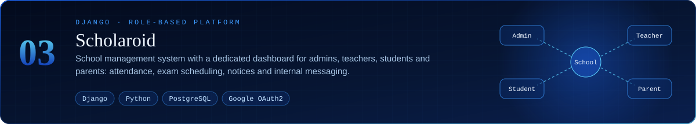</a>

  

<a href="https://github.com/abhi-v-10/eli5">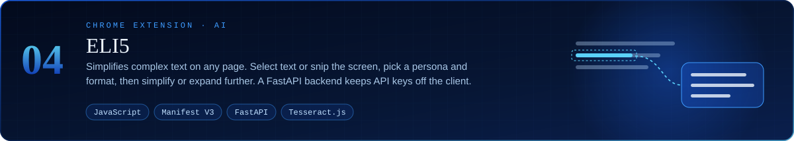</a>

  

<a href="https://github.com/abhi-v-10/MovieDB">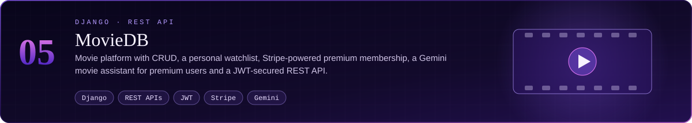</a>

  

<a href="https://github.com/Paardhu22/qp-gen">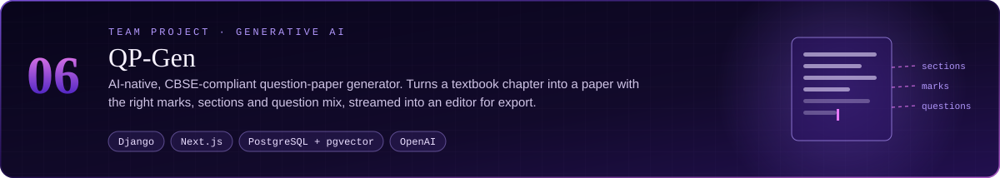</a>

  

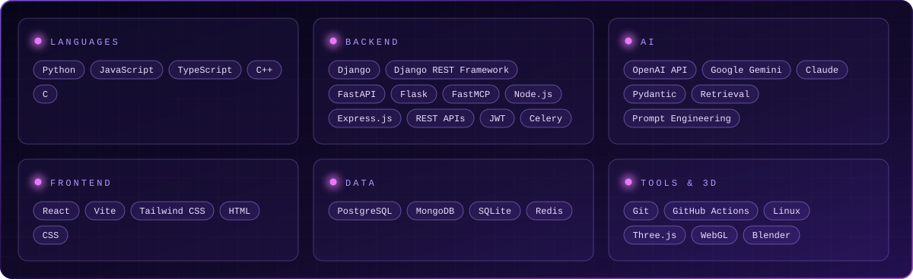

<picture>
  <source media="(prefers-reduced-motion: reduce)" srcset="assets/contributions.svg">
  
</picture>
  
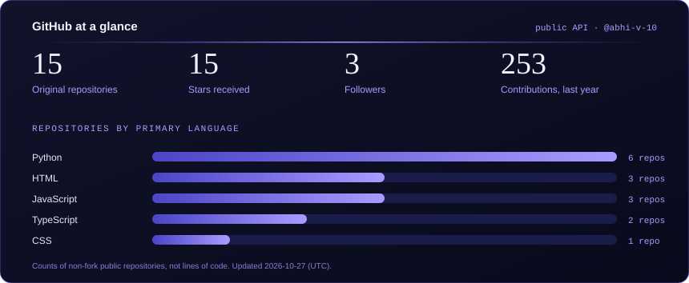

Both cards are generated from real public GitHub data by [`scripts/generate-profile-assets.mjs`](scripts/generate-profile-assets.mjs) and refreshed daily by a GitHub Action. They show public activity only, and language bars count repositories, not lines of code.

<table width="100%">
  <tr>
    <td width="50%"></td>
    <td width="50%"></td>
  </tr>
  <tr>
    <td width="50%"><a href="https://abhi-ai-portfolio.lovable.app/"></a></td>
    <td width="50%"></td>
  </tr>
</table>

<picture>
  <source media="(prefers-reduced-motion: reduce)" srcset="assets/footer-static.svg">
  
</picture>
