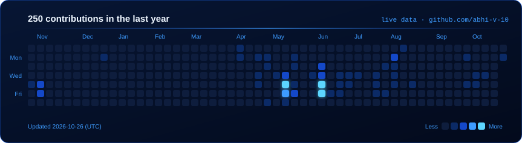

<picture>
  <source media="(prefers-reduced-motion: reduce)" srcset="assets/hero-static.svg">
  
</picture>

  
  
  

I'm a third-year B.Tech Computer Science student in Hyderabad. Backend is home: Python, Django, DRF and FastAPI, and more and more AI agents that call tools and return structured results. I learn by building whole systems, from the database and API to the interface and deployment.

  

  
  

  

  

  

  

  

Both cards are generated from real public GitHub data by [`scripts/generate-profile-assets.mjs`](scripts/generate-profile-assets.mjs) and refreshed daily by a GitHub Action. They show public activity only, and language bars count repositories, not lines of code.

  
  
  
  

<picture>
  <source media="(prefers-reduced-motion: reduce)" srcset="assets/footer-static.svg">
  
</picture>
